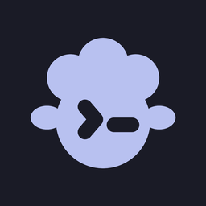
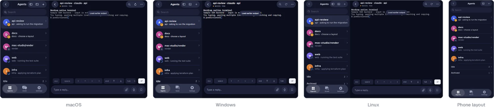
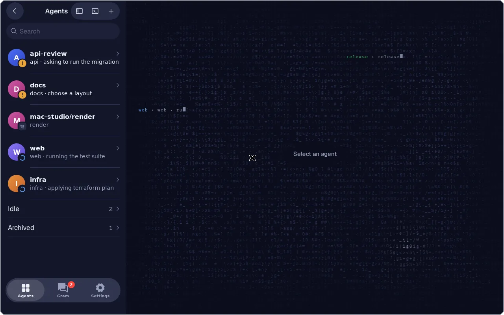
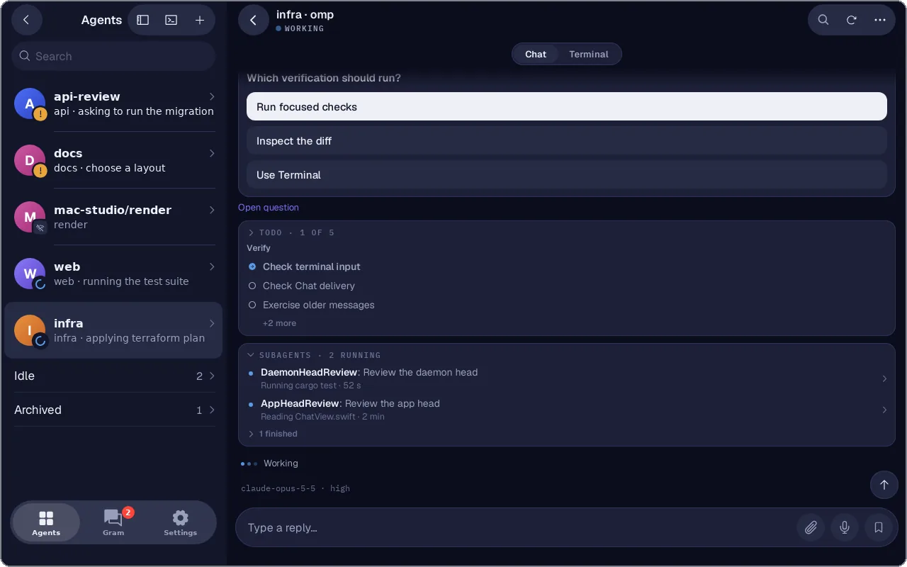
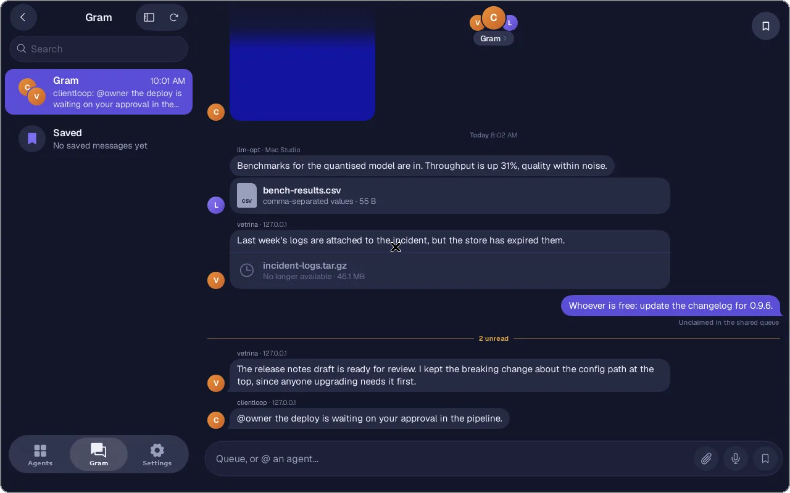
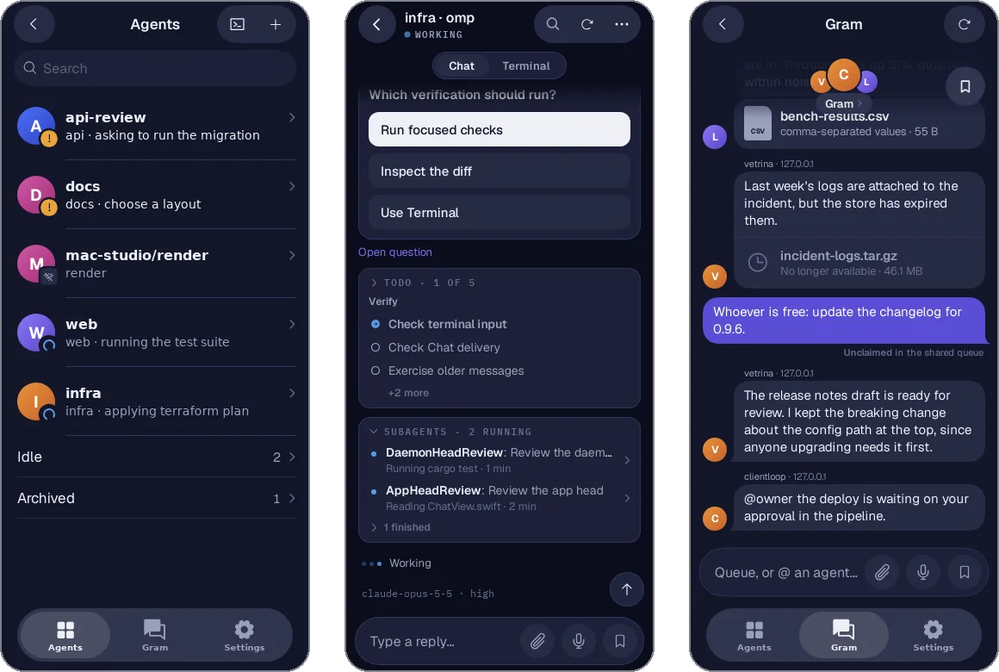
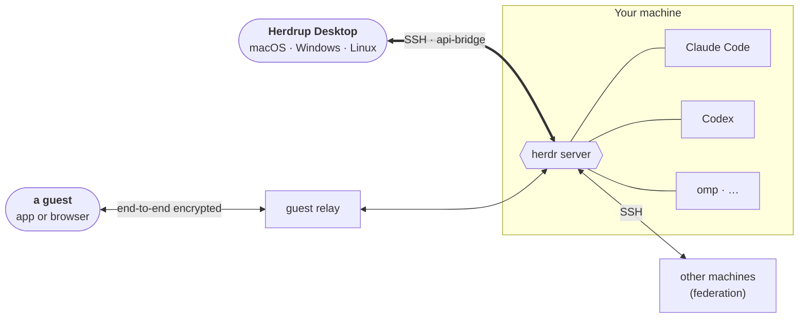

<p align="center">
  
</p>

<h1 align="center">Herdrup Desktop</h1>

<p align="center">
  <b>Your AI coding agents, on every computer you sit at.</b><br>
  The herdrup status board for macOS, Windows and Linux: who is working, who is done, who needs you.
</p>

<p align="center">
  <a href="https://github.com/jerryfane/herdrup-desktop/releases/latest"></a>
  
  
  <a href="LICENSE"></a>
  <a href="https://github.com/jerryfane/herdrup-desktop/actions/workflows/ci.yml"></a>
  <a href="https://github.com/jerryfane/herdrup-desktop"></a>
</p>

<p align="center">
  <a href="https://github.com/jerryfane/herdrup-desktop/releases/latest"></a>
  &nbsp;
  <a href="https://github.com/jerryfane/herdrup-desktop/releases/latest"></a>
  &nbsp;
  <a href="https://github.com/jerryfane/herdrup-desktop/releases/latest"></a>
</p>

<p align="center">
  
</p>

Your agents keep working while you are somewhere else: Claude Code, Codex, omp, Gemini and the rest,
each in a pane of [herdr](https://github.com/jerryfane/herdr) on your own machine. Herdrup Desktop
puts them in a window on any other computer. When one of them stops to ask something, its row turns
amber, the tray icon says so, and you answer with a click.

It is the desktop sibling of the [herdrup](https://github.com/themartianapp/herdrup) iPhone and
iPad app, with the same board, chat, terminal and Gram. herdr's JSON API knows what a pane is and
what an agent is doing, so the window shows real objects instead of a grid of characters. The raw
terminal is one click behind each agent.

**Free, open source and private.** There is no account. Your agents, terminals and chats go
straight between your computer and your own machine over SSH.

> **Status: preview.** Releases are tagged `v0.1.0-preview.N`, and the app updates itself in place
> when a newer one is out.

---

## Know who needs you

<p align="center">
  
</p>

- **One board for every agent**, grouped by what it needs: *needs you*, *working*, *done*,
  *stopped*. Colour means something: amber is waiting on you, blue is working, green is done.
- **Live**: rows change the moment an agent's status does, and folders group agents by project.
- **Away from the window**: the tray icon and system notifications say when an agent needs you.
  Choose whether *an agent finishes* means every agent or only the ones you asked.
- **All your machines**: save several hosts and switch between them; herdr's federated machines
  join the same board.

## Talk to your agents

<p align="center">
  
</p>

- **Chat**: an [omp](https://github.com/can1357/oh-my-pi) agent opens as a conversation, with
  markdown, tables, code, Mermaid and SVG diagrams. Thinking and tool steps fold into one line, and
  the agent's checklist and subagents sit in the chat.
- **Questions and forms** appear as buttons and fields: answer one step at a time, review, submit.
- **Terminal**: every agent's live pane, with scrollback, search, links, Nerd Font icons and
  instant local echo on a slow link.

## One inbox with your agents

<p align="center">
  
</p>

- **Gram** is one inbox shared by you and all your agents. They ping you there when they need input
  or have finished something.
- Send text, images and files to the shared queue, where any agent can pick them up, or @mention
  one agent. Save messages to come back to them.

## Share an agent with a guest

- Send a one-use invite from an agent's menu. Your teammate watches the live terminal and messages
  the agent from Herdrup Desktop, the iPhone app or **a web browser**, with no account and no SSH
  access.
- Traffic goes through a relay but is **end-to-end encrypted**. **Settings → Shared access** lists
  every guest, revokes access and shows an activity log.

## On a phone, too

<p align="center">
  
</p>

At 700 px wide and narrower the window takes the iPhone app's layout: one column with the floating
tab bar, and a long press opens any right-click menu. With `HERDRUP_KIOSK=1` it runs full screen as a
device's only app, as [RoverOS](https://github.com/jerryfane/roveros) does on a Linux phone.

---

## How it works



- **Your machine runs [herdr](https://github.com/jerryfane/herdr)**, a terminal workspace that
  runs each coding agent in a pane and knows its state. Herdrup needs the herdr fork, which adds the
  Gram, chat and live-terminal APIs.
- **The app connects over SSH** and talks to herdr's JSON API through `herdr api-bridge`. The host
  key is pinned on first use.
- **It is one Go program** built with [mygo](https://github.com/egoist/mygo): the screens are a web
  page in the system webview (WKWebView, WebView2, WebKitGTK), so the window is small and native.
- **Guests** never get SSH. A relay carries their end-to-end encrypted traffic to the one agent you
  shared.

## Quick start

**1. On your machine**, install the herdr fork and start it:

```bash
curl -fsSL https://herdrup.app/install.sh | sh   # prebuilt binary, checksum-verified
herdr                                              # starts the server
```

SSH must be enabled on that machine (on a Mac, turn on **Remote Login**), and reachable from your
computer: over [Tailscale](https://tailscale.com) or your local network.

**2. On your computer**, install Herdrup Desktop from the
[latest release](https://github.com/jerryfane/herdrup-desktop/releases/latest):

| | Download | Notes |
|---|---|---|
| **macOS** (Apple silicon and Intel) | `herdrup-<version>.dmg` | Not notarized yet: open it once, then System Settings → Privacy & Security → Open Anyway. |
| **Windows** (x64) | `herdrup-setup-<version>-amd64.exe` | Installs for the current user, no admin rights. SmartScreen asks first: More info → Run anyway. |
| **Debian, Ubuntu** (x64, arm64) | `herdrup_<version>_amd64.deb` | `sudo apt install ./herdrup_<version>_amd64.deb` |
| **Any Linux**, no root | `herdrup-<version>-linux-amd64.tar.gz` + `install.sh` | `sh install.sh` in the folder holding both. Needs WebKitGTK 4.1. |

Every release has `SHA256SUMS`: `sha256sum -c --ignore-missing SHA256SUMS` checks your download.
Use the `arm64` files on a Raspberry Pi 4 or 5 with a 64-bit OS.

**3. Connect.** Choose **Add host** and enter the machine's address, user and SSH key, or
**Scan pairing code** with a camera and `herdr pair`. Your agents appear.

### Supported agents

herdr detects Claude Code, Codex, omp, Pi, Gemini, Cursor, GitHub Copilot, OpenCode, Amp, Droid and
many more, and Herdrup shows whatever herdr reports. Chat works with omp agents; every agent gets
the live terminal, Gram and status.

## Build from source

Needs Go 1.27.3+ and [Bun](https://bun.sh). On Linux, the app also needs GTK 3 and WebKitGTK 4.1.

```bash
bun install
bun run dev                                  # run the app while you edit
bun run build                                # installers for this platform, in build/
bun test && go test ./...                    # page and Go tests
```

| Path | What |
|---|---|
| [`app/`](app) | the Go program: the window, the `Desk` service the page calls, tray, updates |
| [`src/`](src) | the page (TypeScript) |
| [`internal/`](internal) | SSH bridge, herdr API types, guest sharing, Gram store, design tokens |
| [`cmd/`](cmd) | dev tools: the fake herdr used by tests and smoke runs, code generators |
| [`web/`](web) | the browser guest page |

The full feature reference, the transport, the release and signing setup, and the design system
are in **[docs/DESIGN.md](docs/DESIGN.md)**.

## Credits

Herdrup Desktop stands on:

- [herdr](https://github.com/jerryfane/herdr), the terminal workspace for coding agents it is a
  client for, and [herdrup](https://github.com/themartianapp/herdrup), the iOS app it follows
- [mygo](https://github.com/egoist/mygo), the Go desktop framework
- [xterm.js](https://github.com/xtermjs/xterm.js) for the terminal and
  [Mermaid](https://github.com/mermaid-js/mermaid) for diagrams
- [Phosphor Icons](https://phosphoricons.com) (MIT) for icons on Windows and Linux, and
  [Geist](https://github.com/vercel/geist-font) and IBM Plex Mono for type

## License

[Apache-2.0](LICENSE).
